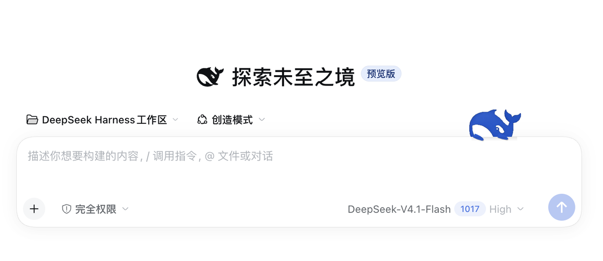
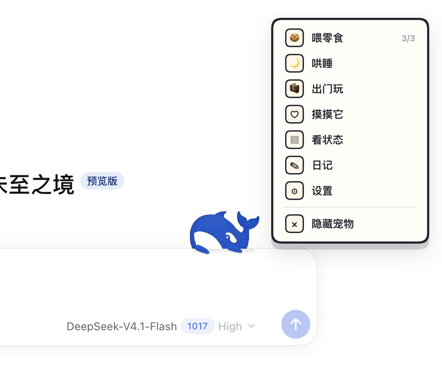
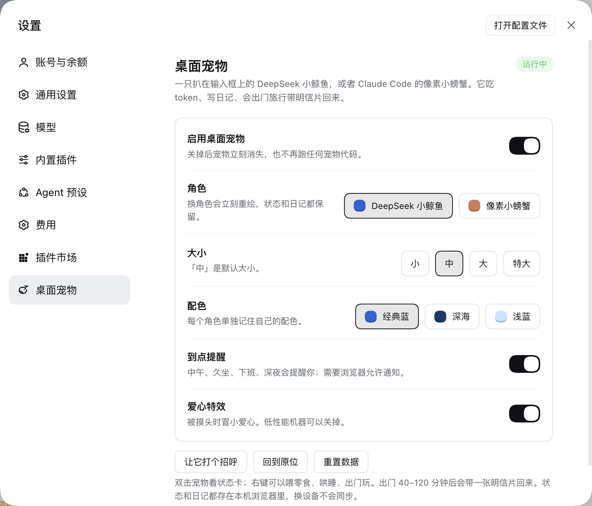
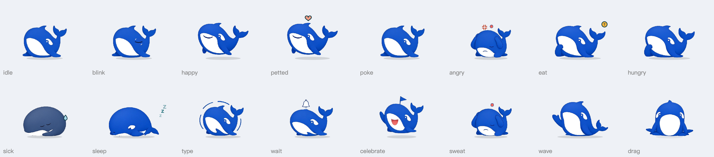

# dsh-desktop-pet

A pet for [DeepSeek Harness](https://github.com/deepseek-ai/deepseek-harness): a DeepSeek-style whale or a pixel crab that perches on the top edge of the DSH input box and reacts to your sessions.

[中文说明](README.zh.md)



| Right-click menu | Settings |
| --- | --- |
|  |  |

All the whale's states (working, waiting for approval, done, error, petted, hungry, asleep…):



## Install

```sh
dsh plugin add git+https://github.com/Kris8888888/dsh-desktop-pet.git
```

Or install it from the plugin market inside DSH. Settings → Desktop Pet has the switches.

## What it does

- **Reacts to the current session**: works while the agent runs, rings a bell when a tool call waits for your approval (click it to jump to that session), plants a flag when a turn finishes, shows a red dot on errors.
- **Eats tokens**: every finished turn feeds it `inputTokens + outputTokens` (cache reads don't count). It gets hungry, sleepy and sick over time.
- **Right-click menu**: feed a snack (3 a day), medicine when sick, pet it, send it travelling (it comes back 40–120 minutes later with a postcard), status card, diary.
- **Perches on the input box**, following it when the page changes; with no input box on screen it stands in the bottom-right corner. **Drag it** anywhere inside the window and it stays there; drop it near the input box to perch again.
- **Settings**: whale or crab, four sizes, three colour skins per character, reminders (noon, long sitting, end of day, late night) and heart effects.

State and diary live in the browser's `localStorage`; nothing is sent anywhere.

## Desktop edition (optional, macOS / Windows)

The plugin above draws the pet inside the DSH window. There is also a floating edition that sits on the outer top edge of the DSH window, gripping it with its fins, and can be dragged onto the desktop. A plugin can't open windows of its own, so that edition patches the installed DSH app (`app.asar`) with an install script — read [docs/desktop-edition.md](docs/desktop-edition.md) before using it. When it's installed, this plugin hands its settings and session events to the floating pet instead of drawing a second one.

## Development

- `lib/` — client source; `tools/build.mjs` bundles it into `client.js` (no dependencies).
- `sprites/` — whale poses cut from the design sheets in `docs/whale-assets/` by `tools/cut_sprites.py`, inlined into `client.js` at build time.
- `pet/` + `tools/install.sh`, `tools/install-windows.ps1`, `tools/patch.mjs` — the desktop edition.

Not affiliated with DeepSeek. The whale is fan art based on the DeepSeek logo; the crab is based on the Claude Code mascot.

MIT License.
