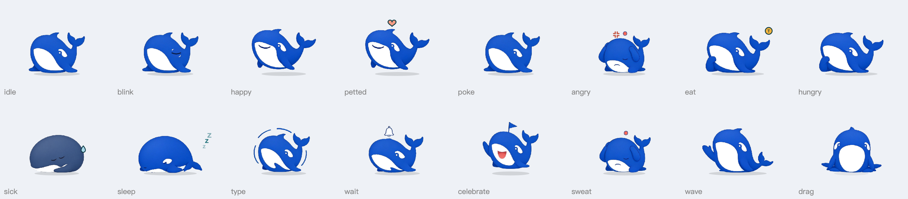

# 桌面宠物 dsh-desktop-pet

给 [DeepSeek Harness](https://github.com/deepseek-ai/deepseek-harness) 的小宠物：一只 DeepSeek 风格的小鲸鱼，或者一只像素小螃蟹，待在 DSH 窗口右下角，跟着你的对话做出反应。



## 安装

在 DSH 的「插件市场」里搜「桌面宠物」一键安装，或者：

```sh
dsh plugin add git+https://github.com/Kris8888888/dsh-desktop-pet.git
```

装好后在 设置 → 桌面宠物 里可以开关、换角色、调大小和配色。

## 它会做什么

- **跟着对话走**：助手在干活时它跟着忙；有操作等你确认时它头上挂铃铛（点它直接跳到那个对话）；一轮做完插小旗；出错头顶冒红点。
- **吃 token**：每轮对话花掉的 `输入 + 输出` token 就是它的饭（读缓存不算）。会饿、会困、会生病。
- **右键菜单**：喂零食（每天 3 份）、生病了喂药、摸摸它、让它出门玩（40–120 分钟后带明信片回来）、看状态、看日记。
- **拖动**：可以拖到窗口里任何位置，会记住。
- **设置**：鲸鱼或螃蟹、四档大小、每个角色三种配色、到点提醒（中午、久坐、下班、深夜）、被摸时冒爱心。

状态和日记存在本机浏览器里，不会上传。

## 桌面浮窗版（可选，Mac / Windows）

上面的插件把宠物画在 DSH 窗口里面。另有一个浮窗版，宠物扒在 DSH 窗口外沿、能拖到桌面上。插件没法自己开窗口，所以浮窗版要用安装脚本改 DSH 的安装包（`app.asar`），用之前先看 [docs/desktop-edition.md](docs/desktop-edition.md)。装了浮窗版以后，这个插件会把设置和对话事件交给浮窗里那只，不会再多画一只。

与 DeepSeek 官方无关。鲸鱼形象是基于 DeepSeek 标志的同人设计，小螃蟹来自 Claude Code 的吉祥物。

MIT 许可证。
