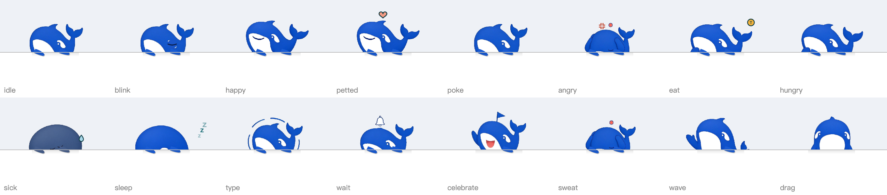

# 桌面浮窗版

插件版的宠物画在DSH窗口里面。浮窗版是一个独立的透明窗口：宠物扒在DSH窗口的外沿（两只鱼鳍搭在边上），能拖到桌面上，5分钟没互动会自己爬回窗口边。



## 先说清楚

DSH不给插件开放「开窗口」的接口，所以浮窗版要用安装脚本改DSH的安装包：

- 在 `app.asar` 里替换 `lib/main.js`（启动宠物窗口）和 `lib/preload-app.cjs`（给设置页一个 `window.__dshPet` 桥），再加一个 `pet/` 文件夹。
- 不解包重打：`tools/patch.mjs` 只改包头、把新文件追加在末尾，`app.asar.unpacked` 里的原生模块不动。
- 改之前会把官方 `app.asar` 备份到 `backup/`，卸载时用它还原。
- DSH升级会用官方安装包覆盖补丁，升级后重新运行一次安装脚本即可。
- 重签名是ad-hoc的：不额外指定要求时，签名里的designated requirement会被钉成当前二进制的cdhash，Squirrel升级校验拿它去比新版本必然失败（报 `code failed to satisfy specified code requirement(s)`）。安装脚本现在会单独给外层写上 `-r='designated => identifier "com.deepseek.dsh"'`，所以打过宠物补丁的DSH照样能升级，升级完再跑一次脚本装回宠物。
- 打补丁用的是DSH自己（`ELECTRON_RUN_AS_NODE=1`），不需要另装Node或Python。

插件版和浮窗版可以一起装：检测到浮窗版时，插件只把设置和对话事件转给浮窗，不会再画第二只。

## 安装

先用插件市场或 `dsh plugin add` 装好插件，然后：

**Mac**

```sh
git clone https://github.com/Kris8888888/dsh-desktop-pet.git
cd dsh-desktop-pet
./tools/install.sh
```

完全退出DSH（⌘Q）再打开。脚本会重新做一次ad-hoc签名。

**Windows**（还没在真机上测过，欢迎反馈）

1. 下载本仓库，解压。
2. 先正常打开一次DSH，再从托盘完全退出。
3. 双击 `安装桌面宠物.bat`。找不到DSH时会让你把它的安装文件夹拖进窗口；装在Program Files里的话，右键「以管理员身份运行」。

## 卸载

- Mac：`cp backup/app.asar.orig "/Applications/DeepSeek Harness.app/Contents/Resources/app.asar"`，`cp backup/Info.plist.orig "/Applications/DeepSeek Harness.app/Contents/Info.plist"`，再 `codesign --force --deep --sign - "/Applications/DeepSeek Harness.app"`。
- Windows：双击 `卸载桌面宠物.bat`。

宠物自己的状态和日记存在DSH的用户数据目录下的 `pet/` 里，重装后还在。

## 交互

| 操作 | 结果 |
| --- | --- |
| 单击头 | 摸头，冒爱心 |
| 单击身子 | 戳一下；6秒内戳3次会生气 |
| 双击 | 状态卡：饱腹、心情、精力、健康、亲密度、在一起天数、吃掉的token |
| 右键 | 喂零食（每天3份）、哄睡、出门玩、摸摸它、看状态、日记、设置、回窗口、隐藏 |
| 拖动 | 拖到桌面任意位置；靠近DSH窗口顶边松手会扒回去 |
| 等你确认时单击 | 跳到那个对话 |

菜单和面板放在宠物旁边（看哪边屏幕空间大），点别处或按Esc收起。趴在窗口上时层级跟着DSH走，在桌面上时浮在最上层。

## 开发

- `pet/` — 浮窗的页面、绘制（`sprite.js`）、状态机（`state.js`）、主进程（`pet-main.js`）。
- `tools/patch.mjs` — 打补丁、装插件、查Electron开关；Mac和Windows共用。
- `tools/cut_sprites.py` — 从 `docs/whale-assets/` 的设计稿切鲸鱼图（`pet/sprites/` 的PNG和三种配色，加根目录 `sprites/` 的WebP）。
- `tests/harness/sheet.html` — 姿势总览：在仓库根目录 `python3 -m http.server` 后打开 `tests/harness/sheet.html?c=whale&m=perch&k=deep&s=1`。
